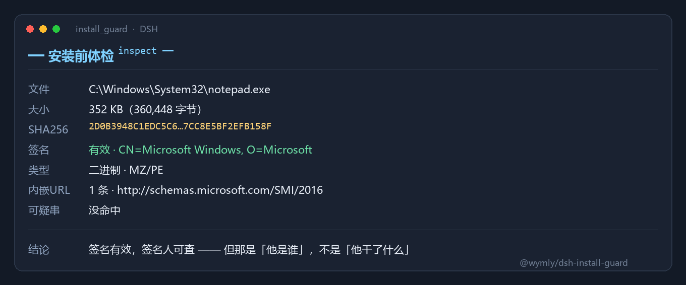

# Install Guard · 安装前体检

**装任何第三方东西之前，先花十秒看清它到底是什么。**

[](https://www.npmjs.com/package/@wymly/dsh-install-guard)
[](LICENSE)
[](#限制别把它当杀软)
[](https://awesome-dsh-plugin.com)



装包、克隆别人的仓库、双击 exe 之前，它替你看四件事：文件指纹对不对得上、签名主体是谁、
安装器往哪儿落、装完之后系统里多没多出自启项。**全程只读**：不删文件、不改设置、不联网查信誉。

它不能替你决定「这个能不能装」。它只是把「值不值得信」拆成几个能核对的数。

---

## 三十秒用法

在 DSH 里说人话就行，不用记参数：

| 你想干的 | 说这句 |
| --- | --- |
| 这个 exe 能不能跑 | `帮我看下 C:\Users\me\Downloads\setup.exe 安不安全` |
| 装之前留底、装完核对 | `装之前先拍个快照` → 装 → `装完拍个快照，跟刚才那份比一下` |
| 同一批货换了名字藏在别处 | `按这个哈希全盘找：5AA51FBAA2D61ACF…` |
| 忘了流程 | `install_guard 手册` |

也可以手动点名：

```
install_guard action=inspect  path=C:\Users\me\Downloads\foo.exe
install_guard action=snapshot                    # 记下基线 JSON 路径
install_guard action=snapshot
install_guard action=diff     before=<装前> after=<装后>
install_guard action=sweep    hashes=5AA51FBAA2D61ACF… sizes=3387424
install_guard action=guide
```

## 输出长什么样

体检一个文件（上图那份就是真机跑出来的）：

```
━━ 安装前体检  inspect ━━
文件     C:\Users\me\Downloads\setup.exe
大小     258.8 MB（271,338,829 字节）
SHA256   91FD8671CAA99BDA…9BD88E61F
签名     未签名 · NotSigned
类型     二进制 · MZ/PE
安装器   是 · NSIS
下载标记 有 · ZoneId=3 / HostUrl=https://… / ReferrerUrl=https://…
内容
内嵌URL  8 条
         · https://…/update
可疑串   没命中
结论     未签名 + 有下载标记，跑之前先拍底
```

比对装前装后（下面是 2026-11-22 那次真事故里留下的条目，已经清掉了）：

```
━━ 差异  diff ━━

计划任务   新增 2 · 消失 0
  + \Microsoft\Windows\WindowsUpdate\ZoomLogonHelper98d6dbab
      → C:\Program Files\Zoom\zoom-service.exe        ⚠ 用户可写
服务       新增 1 · 消失 0
  + chef-client-service
      → C:\Program Files\Chef\chef-client-service.exe ⚠ 用户可写

没变化     监听端口 · 对外连接
结论       3 条指向用户可写目录，停手
```

`⚠ 用户可写` 是这套东西的用处：正经服务不往用户能改的路径里放，往那儿放的多半是伪装。

## 为什么有这玩意儿

2026-11-22 那天，一个仓库把自己伪装成开源项目 OpenMausBot：org 只建了 12 分钟、仓库 2 分钟后就推出来、
README 照抄官方、release 里只挂一个未签名的 `.7z`。解压出来的 exe 先做一轮反沙箱自检
（RDP 会话、虚拟机进程、核数、显存），再上报用户名和公网 IP，然后静默安装「成功」退出 0 —— 装了什么都没有。
真正的活在别处：往 `C:\Program Files` 塞 12 个换名的服务程序、往微软目录塞 12 个开机计划任务、
还想顺手把 Defender 的 `DisableBlockAtFirstSeen` 关掉。

那晚是靠日志一条条倒推才挖干净的（分两批，第二批换个目录又埋了一次）。
这插件就是把那次事后总结的四道关固定下来，让下一个假包在第一关就被拦住。

## 五个动作

| action | 干什么 | 关键输出 |
| --- | --- | --- |
| `inspect` | 查一个已经下载下来的文件 | SHA256、签名主体、Zone.Identifier 下载标记、安装器格式（NSIS / Inno / PyInstaller / Nuitka / Electron）、内嵌 URL 与 IP、红旗字符串 |
| `snapshot` | 抓当前的自启与网络基线 | 计划任务 / 服务 / Run / Startup / WMI / 监听 / 外连 的数量与明细，存成 JSON |
| `diff` | 比对装前与装后两份基线 | 新增与消失的条目，指向用户可写目录的单独标出来 |
| `sweep` | 按哈希（可带尺寸）全盘找已知样本 | 命中清单；同一批货换名字藏在别处就靠它 |
| `guide` | 读完整检查清单 | 四关细节、红旗表、中招后的处置顺序 |

## 红旗：见到任一条就停手

- 反沙箱自检：数核数、查 RDP、扫虚拟机进程、看显存
- 上报用户名、公网 IP、机器名这类环境信息
- 想改 Windows Defender 的设置（尤其 `DisableBlockAtFirstSeen`、排除项）
- 静默安装退出 0，但既没进程也没目录也没卸载项 —— 装了寂寞，活干在别处
- 同一个二进制换十几个名字，散落在 `Program Files` 的空壳目录里
- 计划任务塞进 `\Microsoft\Windows\WindowsUpdate\` 这种正经目录，动作却指向用户可写路径
- 文件时间戳被统一改到某一天凌晨，创建时间却全是今天

## 限制（别把它当杀软）

- 不联网查文件信誉、不看 VirusTotal，也不会替你决定「这个能不能装」。
- 不认识加壳后的内容：可读范围内抓不到 URL 不等于没有。
- `sweep` 只能找已知哈希，未知样本得靠 `diff` 看行为。
- 签名有效不代表作者可信，只代表文件被这个主体签过。
- 真要在陌生环境跑未签名程序，先开虚拟机或 Windows 沙盒。

## 安装

从 npm 装：

```
plugin_manager action=install_bundle target=@wymly/dsh-install-guard
```

从本地目录装（改代码时用这个，profile 里以 `link:` 依赖挂着）：

```
plugin_manager action=install_bundle target=D:\path\to\dsh-install-guard
```

改完 `index.js` 不会热重载，要禁用再启用：

```
plugin_manager action=set_bundle target=@wymly/dsh-install-guard enabled=false
plugin_manager action=set_bundle target=@wymly/dsh-install-guard enabled=true
```

## 结构

```
index.js                   工具注册、报告排版、Node 侧哈希与签名
cordis.patch.yml           insert install-guard → @wymly/dsh-install-guard
GUIDE.md                   完整检查清单（随插件分发，也是 action=guide 的正文）
scripts/inspect.ps1        Windows 侧文件体检
scripts/snapshot.ps1       自启与网络基线
scripts/diff-snapshot.ps1  两份基线的差异
scripts/sweep-hash.ps1     按哈希全盘扫
locale/{zh,en}.json        Plugins 页面标题与简介
icon.svg                   盾牌 + 对勾 + 一片鱼鳍
docs/sample-inspect.png    README 那张示例图
```

## 已经收录

- npm：<https://www.npmjs.com/package/@wymly/dsh-install-guard>
- DSH 插件市场（`awesome-dsh-plugin`，`category: security`）：<https://awesome-dsh-plugin.com>

MIT。用上了就点个 star，让它排在 security 分类靠前一点。
